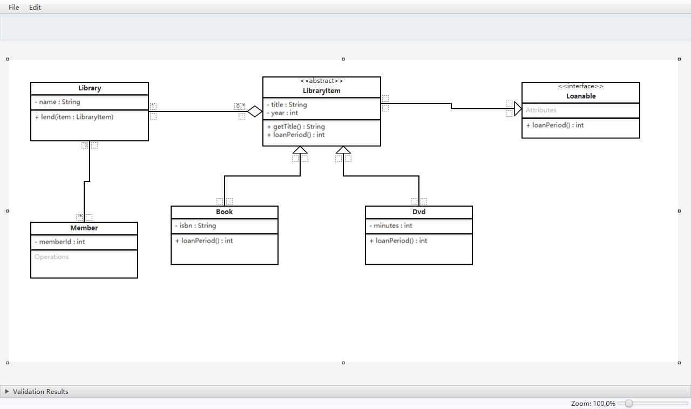

# UML Class Diagram Tool

A JavaFX desktop editor for drawing UML class diagrams: add classes, connect them, get warnings
for broken naming or inheritance, undo mistakes, save the diagram and export it as an image. It
was a group project (six students) for the TU/e course 2IRR00.



*The editor with [`examples/library.unc`](examples/library.unc) open (rendered from the running
app with JavaFX's scene snapshot).*

## What it does

- Double-click the canvas to create a class; edit its name, attributes and operations in place.
- Class kinds: plain, `<<abstract>>`, `<<interface>>` and `<<enum>>` (toolbar when a class is selected).
- Connections: association, aggregation, composition and inheritance, with multiplicities and
  role names at both ends. Drag classes, arrow ends and arrow mid-segments to tidy the layout.
- Validation panel at the bottom: empty names, class names not in PascalCase, attribute and
  operation names not in camelCase, bad visibility markers or multiplicities, a class
  with more than one superclass, inheritance cycles, and classes inheriting from an enum.
- Undo/redo for every edit (Ctrl+Z / Ctrl+Y), built on the Command pattern.
- File > Save / Open: diagrams are stored as XML (`.unc` files, written with
  `java.beans.XMLEncoder`). File > Export as Image: PNG or JPEG.

## Run it

Needs JDK 21 and Maven.

```bash
cd irr00_group_Project
mvn javafx:run
```

Then File > Open file and pick `examples/library.unc` to see the diagram from the screenshot.

Run the tests (137 JUnit 5 tests; GitHub Actions runs them on Ubuntu under Xvfb):

```bash
cd irr00_group_Project
mvn test
```

The `.unc` loader uses `java.beans.XMLDecoder`, which can create arbitrary Java objects, so only
open diagram files you trust.

## Code layout

```text
irr00_group_Project/src/main/java/com/mycompany/irr00_group_project/
  App.java          entry point, Ctrl+Z / Ctrl+Y handling
  representation/   model: DiagramData, ClassNode, UMLConnection
  gui/              JavaFX views; gui/commands/ holds one Command class per undoable edit
  Undo/             UndoRedoManager
  validation/       ValidationRule implementations and the validators that run them
  serialization/    XML diagram files and PNG/JPEG export
```

## Team

| Member | Main areas (from the `@author` tags) |
|--------|--------------------------------------|
| Deniz B. | most of the GUI, commands, listeners, image export |
| Aiham A. | app controller, model, commands, XML serialization |
| Anas N. | undo/redo manager, validation framework and string rules |
| Long P. | model, geometry utilities, XML serialization, tests |
| Abdul G. | model, file classes, inheritance-cycle rule |
| Weiping Y. (me) | unit tests |

**My contributions.** The files with my `@author` tag are tests: `CreateArrowCommandTest`,
`SubjectTest`, `ClassNodeTest`, `UMLConnectionTest`, `UndoRedoManagerTest` and
`InheritanceCycleValidationRuleTest`, plus `FxUtilsTest`, `GeometryUtilsTest`,
`DiagramValidatorTest` and `MultiplicityStringValidationRuleTest` together with Long P.

## License

MIT, see [LICENSE](LICENSE).
